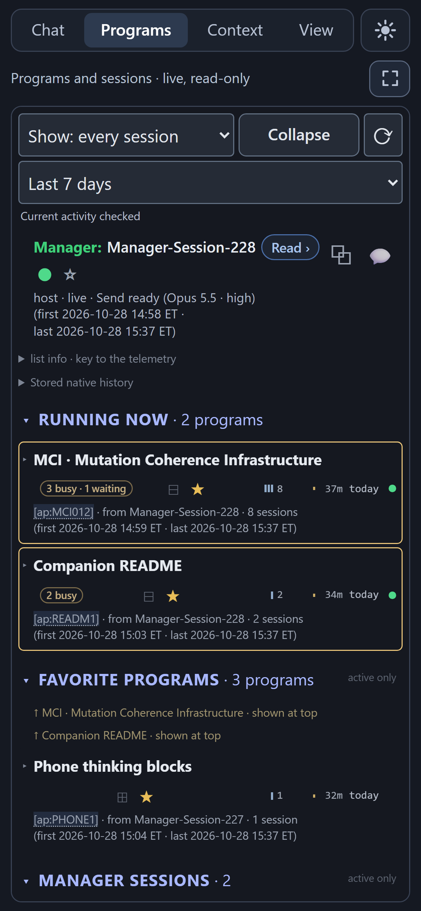
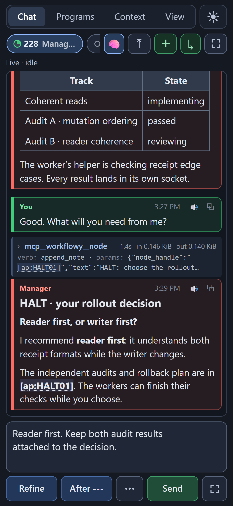

> **Public snapshot, 2026-10-28.** A point-in-time copy of an actively developed private repository; its commit history is omitted. Install instructions are still being written; expect rapid change over the coming weeks.

<!--
Public name: "NEXUS Harness" (repository `nexus-harness`) is the go-public plan's recommendation, not a decision: the name is Dan's to choose.
To swap it, replace "NEXUS Harness" and "nexus-harness" throughout this file.
Every link marked PLACEHOLDER points at a public repository or page that does not exist yet.
-->

# NEXUS Harness

**Run a swarm. Keep the thread.**

NEXUS Harness runs knowledge work and agent swarms through [Workflowy](https://workflowy.com), the outliner. You think out loud with one agent, the **Manager**, in a conversation that files itself into your outline as it goes. When the thinking turns into work, the Manager launches a **program**: a **Conductor** agent that plans it, hands each piece to a worker agent, has the results checked by other agents, and stops to ask you whenever a decision is yours. Programs run for an hour or for weeks, on Claude Code and OpenCode; the longest has used more than a thousand agent sessions. Every plan, prompt, result and decision lands in Workflowy, where you read it as easily as the agents do. The **Manager App**, a local web app for your desk and your phone, shows the whole swarm live.


*The Manager App on the desktop. Left, a dictated reply waiting for Refine and Send, beside the tool inspector open on a Workflowy call. Middle, **Running now**: a program's live tree, with its Conductor sessions, the workers and the helper they started, two independent audits and a HALT, every row with its context use and wall-clock time. Right, the Manager's conversation: where the program stands, and the question the HALT is asking you.*

<sub>Every screenshot shows the app's real, current interface, captured headless on invented records shaped like the system's own development. [How they are made.](docs/readme/README.md)</sub>

> **Human:** you never staff the machinery; you talk about the work.
>
> **Agents:** you never work out of sight; you write it all down.

It is built on [NEXUS](https://github.com/daniel347x/workflowy-nexus)<!-- PLACEHOLDER: the public NEXUS repository (plan: workflowy-nexus) does not exist yet -->, the Workflowy MCP tooling that turns one outline into the shared, visible memory of a person and their agents. This repository adds what runs on top: an advanced skill for managing knowledge work and agent swarms, which lives in Workflowy itself; the command-line tools that launch, watch and steer agents in Claude Code and OpenCode; and the Manager App. One person built it, for others to use too: it runs every day, it still has some raw edges, and it works very well.

**On this page:** [In Workflowy terms](#in-workflowy-terms) · [The Manager Session stream](#the-manager-session-stream) · [Programs](#programs) · [Quick programs and forklifts](#quick-programs-and-forklifts) · [One night](#one-night-from-the-records) · [The Manager App](#the-manager-app) · [Claude Code and OpenCode](#claude-code-and-opencode) · [The skill is a Workflowy subtree](#the-skill-is-a-workflowy-subtree) · [Install (preview)](#install-preview) · [Status](#status-and-honest-limits)

## In Workflowy terms

Everything the harness does is a node in one outline. NEXUS gives agents the tools to work in it: **Anchor Docks** (containers an agent files things into), **Anchor Points** (nodes with a permanent handle, such as `[ap:K7M2QF]`, that any prompt can cite), **slice groups** (tag-selected views rendered as one document) and the **Reader**, which shows any of it beside your outline exactly as an agent receives it. The harness builds on those:

| In your outline | What it holds |
|---|---|
| **A Dock per conversation** (`Manager-Session-228`) | everything the Manager captured while you talked |
| **Residue** and **the Board** | what the next conversation must carry, and every program being followed |
| **A Dock per program** | its purpose in your own words, the Manager's Briefs, its configuration, its Ledger and decisions, and every agent's job |
| **A socket per job** (an Anchor Point) | one agent's instructions, which the agent then fills with its result and an account written for you |
| **The instructions themselves** | the Manager's skill and the Program Conductor Toolkit: a subtree, read a page at a time |

So nothing lives only in a chat log or a terminal. Click a program's root and read its history as one document. Select every `🗣️ For the human` account in a program by its tag and read them in order. Search every program ever run, including the ones long since exported to archive files: finished work leaves the live outline, and stays readable.

The rule NEXUS starts from holds all the way down: *you never describe context; you point at it.* A worker is never handed a paraphrase of what it needs. Its socket names the nodes, by handle, and it reads them.

## The Manager Session stream

*where you think*

The Manager's instructions open with one sentence: *"This is where the human thinks out loud with an agent."* Sometimes that means running programs; sometimes it is a question, a piece of research, a design argument, the plan for a week. The Manager is the colleague you have that conversation with, typed or dictated, in Claude Code or OpenCode.

**The stream is the archive.** Each conversation gets its own Dock, `Manager-Session-001`, `-002` and on, and the Manager captures what matters as Anchor Points while you talk: a ruling, a plan agreed, the story behind a decision, a to-do. You never classify anything as you go; the Manager does that for you. The stream is allowed to be enormous, because nobody reads it front to back: it is searched, and what matters is carried forward on purpose.

- **Residue** is one short note that travels into the next conversation: the current focus, what is still being argued, what a successor should verify rather than trust, and the mood of the work. It holds pointers, not content.
- **The Board** lists the programs being followed. Its bias is the opposite of Residue's: nothing leaves it until the program is sealed.
- **Curation is about forgetting.** Say "curate", and the Manager walks everything new and decides, on your behalf, what happens to each item. Most things are let go: still findable, never mentioned again. Some are carried in Residue, some are promoted into the topic Dock where you would go looking for them, and only the genuinely grey ones come back to you as a question.

The next Manager starts from Residue and the newest captures, not from a summary of a chat, and walks in as a colleague who was there yesterday. There have been 228 Manager Sessions so far.

The Manager is also your one point of contact for every program. It launches them, reads their records, tells you what a waiting Conductor is asking and why, and relays your answer.

## Programs

*where the work gets done*

A program is a Dock with a Conductor. You give it a purpose and a spine: what to build, roughly in what pieces, what must not change, where to stop and ask. The Conductor supplies everything else: the plan, the casting, the prompts, the audits and the repairs. A full program's Conductor always starts from the same line (the launcher adds the program's handle):

```text
You are the CONDUCTOR. Read [ap:QE4RXD] and follow it.
```

Everything else the Conductor reads from Workflowy: its initialization page, then the program's **SkyView** (what you are actually trying to get, in your own words), the Manager's **Briefs** (its notes to the Conductor) and the program's configuration. For every job it writes a **socket**: an Anchor Point that opens with a dispatch (the role, the model, what to read and in what order, what the agent may write, what it is measured against), followed by the instructions for that one run. The agent reads its socket, does the job, and fills the socket in place with its result and a `🗣️ For the human` account in plain language.

What lets a program run for days without you, and without falling over:

- **Each role on the model best at it.** *GPT does; Claude decides.* GPT-6.1 Sol writes specifications, implements and finds problems; Claude Opus or Fable adjudicates, writes the workers' prompts and conducts. One program mixes both, and any other model in the cast.
- **Fresh eyes judge.** Work is audited by agents that did not write it. A split audit runs in two steps: a findings auditor lists everything that looks wrong and decides nothing, then an adjudicator decides, finding by finding, what the program's bar actually blocks. What it blocks is fixed and checked again; the rest goes to the program's **Ledger**, where every known defect and obligation waits for a fate.
- **Handoffs, not summaries.** Automatic compaction is off everywhere. Every agent measures its own context window (`context_status`) and lands its work cleanly at its own target, marked partial if it is unfinished. A Conductor near its limit hands the program to a fresh Conductor session through Workflowy, and the next one picks up where it left off.
- **Read once, start warm.** A pre-pass agent reads a program's shared background once. Prompt authors forked from it write each worker's prompt, and each worker starts from that prompt and goes straight to work.
- **Code by map, not by search.** In a repository that NEXUS's Cartographer maps into the outline, workers find code through beacon slices (the signature and comment of every tagged function, across files, in one read) and open a function by name.
- **HALTs.** The Conductor stops at the decisions that are yours, with its question, the options, its recommendation and the evidence by handle. You answer in a sentence, from your phone if you like; the Manager relays it, and the program goes on.

From the outside, it comes down to one command. `oc.sh view "[ap:PROG]"` (the boom) prints a program's registry, its state, its live sessions and newest telemetry, and pushes its plain-language accounts into the Reader beside your outline.

**The longest program so far is MCI,** the Mutation Coherence Infrastructure for NEXUS: the machinery that keeps NEXUS's view of the outline consistent while many agents write to it at once. In 26 days it has used 1,145 agent sessions: 76 Conductor sessions, one after another, each reading the record, doing its stretch and passing the baton, and 1,069 workers and helpers. It has run four waves and 31 audit rounds, and stopped at least seven times for a decision only a human could make. One wave-end audit fanned out over 14 parallel shards, about 18,000 rows of evidence in 75 categories, and still spoke with one verdict: the shards gathered, one writer decided. Its Ledger holds 180 items, 81 of them deliberately on hold, and none waiting for a decision.

### Quick programs and forklifts

Not every job needs the full procedure. A **quick program** is one bounded job, started in a minute or two, owned by a Conductor so that it outlives the conversation that launched it, with one place that says where it stands. It promotes itself to the full procedure if the job turns out bigger than it looked.

A **forklift** is the fastest way to start one. Say "forklift this", and the Manager forks its own conversation, in one background call, into a copy that already knows everything you discussed. The copy checks for running work it would collide with, prepares the program and launches it while you keep talking, and its **doorbell**, a background wait in the Manager's conversation, rings when the program is running or done.

Why that matters, in its author's words: *"that few minutes is when I've got five things on my mind … I just want to say them, and only have to wait thirty seconds between each thing."*

## One night, from the records

*October 27 to 28, 2026. Every program here is the harness's own development.*

Early in the evening, one sentence to the Manager launched two forklifts, and the conversation was back in 16 seconds. By the end of the night, two Manager conversations had launched 17 of them. Each forklift prepared and launched its program in three and a half to eight minutes while the talking went on. Thirteen were quick programs, and each landed its result between 11 and 56 minutes after the ask: a favorites section in the sidebar, fixes for the phone, forklifts for OpenCode Managers, a listening mode for technical replies. Three were, or became, full programs; one of them made the Ledger tools almost seven times faster (a real listing went from 35.6 seconds to 5.3).

One quick program's result was a launch package for an impact assessment. When it finished, the doorbell rang 28 seconds later, and within a minute the Manager had read the package and launched the assessment with a second forklift. The assessment will plan the next waves of MCI. So one forklift's program wrote the plan for a second program, a second forklift launched it, and its job is to plan the waves of a third: *"quadruply nested"*, in its author's phrase. Orchestration is work you can hand off too.

The seventeenth, one of the night's last, launched the program that wrote this page.

## The Manager App

*the swarm on one screen*

The Manager App is a local web app that sits beside your agents on the desktop and travels on your phone. It began as a dictation pane, and its folder still says so: `transcription-pane/`.

- **Talk to the Manager.** Dictate or type into a persistent editor. ✨ **Refine** cleans up the dictation with a model that reads the conversation as context; 📤 **Send** delivers it to the Manager, in Claude Code or OpenCode.
- **Read every agent.** The Manager's conversation streams live, and any tool call opens on its exact input and output. Any other session, a Conductor, a worker or a helper, opens read-only.
- **See every program.** Each program is one live tree: the program, its Conductor sessions, the workers each one started and their helpers. Every row shows its status, its context use and its wall-clock time; a program's row shows how many sessions it has used, how long it has run and how old it is. Busy programs rise to **Running now**; starred ones stay in **Favorite programs**.
- **Read Workflowy in place.** 📄 **View** renders any Dock, slice group or node exactly as the NEXUS Reader does, with the same code, and every `[ap:…]` handle anywhere in the app opens there.
- **Listen.** 🔊 **Read Aloud** turns a reply into a version written for listening, and plays it.
- **Watch the quotas.** Gauges show how much of each subscription window is used and when it resets.
- **From the phone.** `/m` puts Chat, Programs, Context and View on a phone, over your own private network, with a glare mode for reading outdoors.


*The same program in 📄 **View**: the Workflowy document behind it, drawn by the NEXUS Reader's own renderer, with its waves, its two independent audits and the decision it is waiting on, beside the live tree.*

<p align="center">
  
  &nbsp;&nbsp;
  
</p>

*The phone page, `/m`. Programs: what is running, what is waiting, and your favorites. Chat: the Manager has relayed a HALT, and your answer is one line.*

## Claude Code and OpenCode

Both runtimes are supported, and one program can use both.

- **Claude Code** runs headless on your Claude Max subscription through this repository's host (`scripts/claude_host.sh`), a local owner of the official Claude Code CLI. It starts and supervises Managers, Conductors and workers, keeps exact send receipts and replayable records, offers interrupt, model and effort controls that read back what was applied, and halts in plain view at a usage limit instead of retrying blind.
- **OpenCode** runs as one local server, with any provider; on it, GPT-6.1 Sol does most of the doing. This repository adds a layer around it: a payload proxy in front of every model provider (prompt caching under control, and rate limits ridden out for about 25 minutes before OpenCode sees one), five plugins (`context_status` among them), a master configuration with auto-compaction off, a restart that proves every new configuration on a throwaway server first, and upgrades checked against the new OpenCode source, with rollback.
- **One set of tools drives both:** more than 30 `oc_*` commands behind one launcher, `scripts/oc.sh`. A session is `ses_…` on OpenCode and `cc-…` on Claude Code, and the tools take either.
- **The cast:** 71 agent files, most of them one per model and thinking level, across Claude, GPT, DeepSeek, Gemini, GLM, Grok, Kimi and Qwen: model wrappers for this setup, not drop-in files. On Claude Code, the prompts are composed at launch from the same sources, with a drift check that warns loudly if the two have come apart.
- **CodeNomad:** a small Chrome extension tells the app which session is on screen in CodeNomad, a third-party OpenCode web client. It is used less now that the Manager runs on Claude Code.

## The skill is a Workflowy subtree

The Manager's instructions and the Program Conductor Toolkit together are a well-developed skill for agentic swarm management, and it is not a file in this repository. It is a Workflowy subtree:

- **Manager Sessions:** the Manager's own description (about 200 KB) and the standing pages it reaches by handle: curating, seeding and steering programs, quick programs and forklifts, sub-sessions.
- **The Program Conductor Toolkit:** about 150 pages, 1.7 MB: the Conductor's initialization, the dispatch schema, a recipe for every block a program is made of, the role manuals, a shelf of worker clauses and the audit bars.

Nobody reads all of it. An agent loads one page and follows handles as the work calls for them: progressive disclosure, by design. Every prompt in the system is some form of *"Read [ap:X] and follow it,"* and loading the skill is no different. Add the public subtree to your own Workflowy and start a Manager with one line:

```text
Read [ap:MANAGER] and follow it.
```

<!-- PLACEHOLDER: [ap:MANAGER] stands for the public Manager Sessions subtree's Anchor Point; the public subtree and its share link do not exist yet. -->

Then change it to suit you. It is an outline.

## Install (preview)

> [!NOTE]
> NEXUS Harness runs every day on its author's machines, and installing it elsewhere is still being smoothed. The steps below describe what installation is expected to look like; they are not yet a tested path for others.

**You need** [NEXUS](https://github.com/daniel347x/workflowy-nexus)<!-- PLACEHOLDER: public NEXUS repository --> with a Workflowy account, set up as its README describes; Windows with WSL (the harness runs in WSL, beside NEXUS on Windows); Python 3.10 or newer; Chrome; and Claude Code with a Claude Max subscription, or OpenCode, or both.

**1 · Clone** this repository inside WSL:

```bash
git clone https://github.com/daniel347x/nexus-harness.git
cd nexus-harness
```

<!-- PLACEHOLDER: the public repository nexus-harness does not exist yet. -->

**2 · Start a runtime.** For Claude Code, start the host: `bash scripts/claude_host.sh start`. For OpenCode, install this repository's configuration, plugins and agents, and restart its service: `bash scripts/restart_oc_server.sh`.

**3 · Start the Manager App:** `bash transcription-pane/start.sh`, then open `http://127.0.0.1:9911`. On a phone, open `/m` over your own private network ([Tailscale](https://tailscale.com) works well).

**4 · Load the skill.** Add the public Manager Sessions subtree<!-- PLACEHOLDER: share link --> to your Workflowy, press **+ New Manager** in the app, and send the one line above.

**5 · Talk.** Say what you are working on. When something is ready to be built, say "forklift it".

Details: [`docs/REFERENCE.md`](docs/REFERENCE.md) (every command) and [`transcription-pane/README.md`](transcription-pane/README.md) (the app, part by part).

## Status and honest limits

**Working, and used daily:** the Manager App on desktop and phone; the Manager CLI and its seats (agent sessions started warm from a shared reading); the OpenCode layer; the Claude Code host (the youngest piece, from October 2026); and the two Workflowy subtrees, Manager Sessions and the Toolkit.

**Next:** the public skill subtree, with a Markdown copy beside it for any agent to read; instructions made generic; configurable paths and a one-line install; a short video of a program running.

**Limits, said plainly:** one person built it, for one person's machines. It assumes Windows with WSL, Chrome, a Workflowy account with NEXUS, and Claude Code or OpenCode, and many scripts still carry that machine's paths. The instructions were written for their author's setup and are being made generic. The agent files are wrappers for one setup. Swarms spend real model quota: the harness shows how much, and stops at a usage limit rather than pressing on.

**By the numbers:** more than 30 command-line tools · 71 agent files across eight model families · about 3,200 Python test functions and 55 JavaScript test files, including headless-Chrome checks of the app's real pages · 228 Manager Sessions · MCI: 1,145 agent sessions in 26 days · 17 forklifts in one night. (Counts from the program records, October 28, 2026.)

## Who made this

This is not a company. It is one person.

I'm Daniel Nissenbaum: an ex-principal at Microsoft (five years), an individual contributor; never that active in open source, incredibly active in private source. NEXUS gave my agents a shared memory I could see; this is what I built on it once they started working in swarms. Agents wrote the code, and the programs that built the harness ran on the harness. This page was made the same way: a forklift launched a quick program overnight, and its worker, Claude Opus 5.5, sent GPT-6.1 Sol helpers to gather the material, make the screenshots and sweep the draft for anything private or overclaimed, then judged each finding itself before it landed. I drove every idea and insisted on good design. I'm not much of a marketer, but I have something I'd like to share, and this is the work.

## Reference and license

- [`docs/REFERENCE.md`](docs/REFERENCE.md): the operator reference (the previous README): the Manager CLI, seats, forks and forklifts, doorbells, telemetry.
- [`docs/claude-headless-host.md`](docs/claude-headless-host.md) and [`docs/claude-headless-manager.md`](docs/claude-headless-manager.md): the Claude Code host and the headless Manager.
- [`docs/server-lifecycle.md`](docs/server-lifecycle.md): what the OpenCode restart does, step by step.
- [`transcription-pane/README.md`](transcription-pane/README.md): the Manager App, part by part.
- [`docs/readme/README.md`](docs/readme/README.md): how this page's screenshots are made.
- [NEXUS](https://github.com/daniel347x/workflowy-nexus)<!-- PLACEHOLDER: public NEXUS repository -->: the Workflowy tooling underneath.

MIT License<!-- PENDING: Dan to confirm MIT; no LICENSE file has been added yet. -->. Built with Workflowy, Claude Code and OpenCode, not by them: NEXUS Harness is an independent project.
