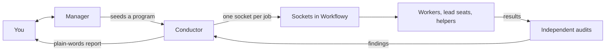

<!-- Draft C of the Manager App README (Open-Source Portfolio Push). Screenshot and video stubs are marked 📸 / 🎬; open questions are marked [TODO Dan: …] / [CONFIRM Dan: …]. -->

# The Manager App

### Agent swarms, with a memory you can see.

`[TODO Dan: repository name]` · runs agents in the official **Claude Code** CLI and in **OpenCode** · keeps their memory in **Workflowy**, through the Workflowy MCP tools `[TODO Dan: link to the Workflowy MCP repository]`

You think out loud with a **Manager** agent. When the thinking turns into work, the Manager hands it to a **Conductor**, which runs a swarm of workers: they plan, write code, audit one another and fix what the audits find. Every brief, dispatch, result and decision along the way is a node in one shared outline, which you and every agent read at the same time, as Markdown. The **Manager App** is the cockpit for all of it, at a desk or on a phone.

It was built by one person ([who](#who-made-this)) and a great many agent sessions, using the system itself. Even this README came out of a program it ran ([how](#how-this-readme-was-written)).

> 📸 **SCREENSHOT — hero, the cockpit mid-program:** The Manager App on the desktop, in Chrome, full window, at `http://127.0.0.1:9911` in **Claude** mode, during a live program run (an MCI wave is ideal: it is open-source work). Visible, left to right: the transcription column with a one- or two-sentence dictated draft in the editor and the ✨ Refine and 📤 Send buttons; the tool column with one Workflowy tool call open (input above output); the conversation column on **💬 Conversation**, its status banner reading *Running tool* or *Writing*, and the conversation view's sidebar with the program tree expanded to show the running program, its Conductor and at least three workers, spinners going, context and wall-clock figures showing. Before capturing, check that no session, program or message title in view touches paid work; collapse or crop anything that does. 16:9, browser chrome cropped.

**What's here**

- **A point of view on context management:** memory as nodes, selected by tags, rendered as documents, cited by handle → [Context is the whole game](#context-is-the-whole-game)
- **A skill for running agent swarms**, written as a Workflowy subtree: the Manager instructions and the Program Conductor Toolkit → [The skill is a Workflowy subtree](#the-skill-is-a-workflowy-subtree)
- **The machinery that runs it:** a host for the official Claude Code CLI, forkable agent seats, the Manager's command line and a hardened layer over OpenCode → [Under the hood](#under-the-hood)
- **The Manager App itself**, desktop and phone → [The cockpit](#the-cockpit)

## Context is the whole game

Underneath, every agent harness is a context-management system. What decides whether an agent does good work is rarely the model. It is what the agent was given to read: the right things, not too much, not too little, and still true. Anthropic's engineers call this [context engineering](https://www.anthropic.com/engineering/effective-context-engineering-for-ai-agents), *"curating and maintaining the optimal set of tokens,"* and they name its failure mode: context rot, recall that degrades as the window fills.

The industry has converged on a good answer: **curate Markdown, and disclose it in stages.** Instruction files (CLAUDE.md, AGENTS.md), rules that load when a matching file is touched, skills that load on demand, memory indexes that point at topic files, and compaction and subagents for the overflow. We agree with all of it. Then it meets months of real work:

- **The files sprawl and go stale.** *"The LLM never trims, only amends,"* as one practitioner [put it](https://news.ycombinator.com/item?id=49945933); another: *"stale docs (they all get stale) are a constant drag."* The vendors' own features concede the point: Claude Code now ships an audit for outdated and conflicting instructions, Codex stops reading instruction files past 32 KiB by default, and GitHub Copilot expires its memories after 28 days.
- **More is not better.** An ETH Zurich study found that context files [do not generally raise task success](https://arxiv.org/abs/2602.11988) while raising inference cost by over 20%. Selection matters more than volume.
- **Selection is coarse.** Context is chosen by file path, by folder, by a model's guess from a description, or by similarity search. None of these lets a human hand one agent exactly the eleven notes it needs, hand the next agent a different nine, and see what each of them got.
- **Memory you didn't write.** Consumer assistants keep a memory they synthesize for you, which you can correct but didn't author. OpenAI's new always-on Dots keep notes of their own that, by early accounts, users can't open one by one.
- **Summaries lose things.** When a Claude Code session compacts itself, its path-scoped rules and nested instruction files go with it: in the documentation's own words, compaction [*"summarizes them away with everything else."*](https://code.claude.com/docs/en/context-window.md)

Files are the right way to store a document. We think they are the wrong way to store a memory.

## Memory as nodes

So we keep the Markdown and change what it lives in: **a graph of nodes, in one document.** ("We", throughout, is me and the agents I work with.)

- **A node is a unit of memory:** a decision, a plan, a brief, a worker's report, a research finding. Each one is a full Markdown document, and the durable ones carry a permanent handle, like `[ap:K7M2QF]`, that survives renames and moves. Prompts, reports and other notes cite memory by handle, never by path.
- **Tags cut across the tree.** A node joins a selection by gaining a tag (`#project-launch`, say), and a saved selection, a *slice group*, renders as one Markdown document drawn from any number of branches, without a file being created.
- **Order is yours.** Move a bullet and the rendered order changes. Indent, outdent and regroup in a fraction of a second.
- **It is all still Markdown.** Every node renders as Markdown and exports to Markdown files whenever you want them on disk.

At any moment, only a few of those nodes matter to any one agent. This is how I picture it:

> *Imagine the nodes out in space. A set of them lights up for one agent, then another set lights up for the next one: little dots of light, lighting up and vanishing. That is context management.*

That is what this harness does all day. A Manager lights up its session's notes and the pages it has been pointed at. A Conductor lights up its program's Brief and Ledger. Each worker lights up its own instructions, the pages those instructions name and its slice of the code, and nothing else. Thousands of nodes in an outline is par for the course; thousands of Markdown files is a sprawl.

## Why Workflowy

An outline is the right shape for this kind of memory, and [Workflowy](https://workflowy.com) is the best tool we know that supports that paradigm. Three things make it fit.

**One document.** Everything lives in one tree. It can hold anything, but it is not a file system, and that is the point: a file system is too powerful to manage (which disk, which folder, which of several writers wins?). Sometimes the constraints are as powerful as the flexibility.

**Structure at the speed of thought.** Tags are native, order is wherever you drag it, and restructuring is a keystroke. A file browser sorts by name or date and turns every reorganization into a project.

**The view comes free.** You can't separate the database from the way humans view it. The memory every agent reads is the same outline you browse, edit and reorder, and a rendered selection is just a projection of it. Put the same nodes in SQLite and you would immediately need a viewer, then a way to tag, then a way to set order: you would be rebuilding an outliner. If Workflowy didn't exist, it would have to be invented.

The tools that make Workflowy agent-ready are their own project, the **Workflowy MCP repository** `[TODO Dan: link]`: eight tool families for reading, writing, tagging and rendering the outline; a Chrome extension with a docked Markdown panel that renders any branch or tag selection as one document; and Cartographer, which maps source code into the same tree. This repository is the harness built on top of them.

The trade-offs are real: a cloud service you don't own, API rate limits, and a dependency on that MCP layer. Growth, at least, is handled: finished branches export to verified archive files that the tools still search and render. The 211 Manager sessions so far come to about 7 MiB live in Workflowy, and 137 MiB counting the exported archives.

## The mirror image

The Workflowy tooling underneath is half knowledge work and half source code. The harness on top of it has the same two halves.

| | Knowledge work | Source code |
|---|---|---|
| **The tooling** (the Workflowy MCP repository) | Anchor Docks, Anchor Points, slice groups, the docked Markdown panel | Cartographer maps, beacons, beacon slices, live snippets |
| **The harness** (this repository, plus two Workflowy subtrees) | **Manager Sessions**: think, plan, remember, curate | **The Program Conductor Toolkit**: swarms that dispatch, write, audit and remediate |

The **Manager App** is the cockpit for both.

**Manager Sessions** is where the thinking happens. **The Program Conductor Toolkit** is where it gets done: it was built to run agentic swarms that write code, and it runs knowledge-work programs too. They are one system because the work is one thing. To do source code well you have to be able to strategize the work, and to strategize you need a memory that holds. It is for architects, planners and founders, and for non-technical people who find themselves running technical projects.

And all of it is Workflowy-centric. All of it.

## The Manager

> *This is where the human thinks out loud with an agent.*
> — from the Manager instructions

A Manager session is a conversation with an agent that keeps a proper record. Each session gets its own **Anchor Dock**, a container node in the outline. As you talk, the Manager captures what matters as **Anchor Points**: decisions, plans, research, to-dos, each a Markdown note with a permanent handle. It decides where things go, so you don't have to. Later, **curation** promotes what lasts into topic Docks, and two standing pages, **Residue** and the **Board**, carry what is still in motion into the next session. The next Manager starts from the record, not from your memory of it.

When a conversation turns into work, the Manager seeds a **program**, launches its Conductor, steers it while it runs, and brings back the result in plain words.

There have been 211 Manager sessions so far, and keeping them straight is the whole job: *"There is absolutely nothing trivial about keeping organized when there's hundreds of sessions and ten different topics."*

> 📸 **SCREENSHOT — a conversation becomes a record:** Workflowy in Chrome, zoomed into one recent Manager-Session Dock whose captures are about open-source work: 6–12 Anchor Points with their emoji titles and `[ap:…]` handles visible, notes collapsed, docked panel closed. Read every title in view before capturing; nothing personal or work-related. Crop to the outline.

## The Conductor

A program is run by a **Conductor** agent. It has one prompt, and the prompt never changes:

```text
You are the CONDUCTOR. Read [ap:QE4RXD] and follow it.
```

Everything else is in the outline. The Conductor plans the program as a tree of stages and units, and for every job it writes a **socket**: an Anchor Point whose note opens with a **dispatch**, which gives the worker's role, its contract, what it must read (by handle), what it must not read, and exactly what it may write. Below the dispatch go the Conductor's instructions for this one run. A worker starts from one line, *read your socket and follow it*, does the job, and fills the socket with its result and a short account for the human. The Conductor reads the results, sends the work to independent auditors, rules on what they find and has it fixed: **implement → audit → remediate**, then halt for the human at the decisions that matter.

Here, abridged, is the dispatch that commissioned this README:

```yaml
dispatch:
  role: PROSE_WORKER
  mode: CREATE
  target: {ap: "docs/portfolio-drafts/README-manager-app-variant-C.md", version: "new file"}
  contract: ["this socket's prose", "[ap:5UJ2W5]", "[ap:JGZ0HL]"]
  inputs: ["[ap:J8XFUQ]", "[ap:5UJ2W5]", "[ap:JGZ0HL]"]
  worker_clauses:
    - {handle: "[ap:TQPZKC]", load: before}   # UNMETERED SEAT
  reads_forbidden: ["the other five README drafts and their sockets"]
  writes:
    - {where: "this socket", how: fill}       # the report, plus an account for the human
    - {where: "docs/portfolio-drafts/README-manager-app-variant-C.md", how: edit}
```

Every `[ap:…]` in it is a node: the brief, the program's orientation page, a clause of standing instructions. The worker reads each one by handle. Nothing is pasted into its prompt, and it may write only what it was granted.



What makes it hold up:

- **Forks carry the whole mind.** *Forking is the right primitive, because design and implementation are coupled.* A **seat base** is a parked agent session that has already read a program's shared material. Lead seats and helpers are forked from seat bases, so each one starts with the whole picture instead of a lossy summary.
- **The anchor is the merge-back.** *Forking is solved; merging back isn't, so we made the anchor the merge-back.* Every fork writes its conclusion into its socket, and the socket is what survives.
- **Every agent knows how full it is.** A `context_status` tool, in both runtimes, reports each agent's real context fill against its own target. At the target the agent lands its work cleanly, marked PARTIAL if it is unfinished, and the Conductor arranges the continuation. Nothing compacts itself.
- **Code is read by map, not by grep.** Workers find code through **beacon slices**: short comments that agents keep above the functions that matter, mapped into the same outline by Cartographer and read live from disk by name. One governed map refresh per unit keeps the map current.
- **A cast, not a model.** About seventy agent files, most of them one per model and thinking level, across several providers. Agents run either in the official Claude Code CLI or in OpenCode, and one program can mix both.

In Workflowy, a program looks like this: on the left, the program as an outline of sockets; on the right, the Workflowy extension's docked panel, showing a node as one Markdown document.

> 📸 **SCREENSHOT — a program is a tree of sockets:** Workflowy in Chrome, zoomed into one finished unit of the MCI program `[TODO Dan: which unit]`, expanded one level so its children show: the unit's ⚖️ sockets (DISPATCHED, RESULT, DECISION, whichever it has), a few `🔧 Helper` sockets and the `🗣️ For the human` children; notes collapsed, docked panel closed. Crop to the outline.

> 📸 **SCREENSHOT — one socket, read as a document:** The same tab with the extension's docked Markdown panel open on the right (the widget's 📌 Dock button) and one worker's RESULT socket selected, so the panel shows its `dispatch:` block at the top and the start of the worker's report beneath it; the outline stays visible on the left with that socket highlighted. Caption: *The same node, two ways: as an outline on the left, as a document on the right.*

## How this README was written

I described what I wanted to a Manager, out loud, and it captured my words into a handful of pages in Workflowy: the core message, the plan, the open questions. A Conductor turned those pages into a program. First came fact-finding: an inventory of every component with its real status and size, research into how today's memory products work, a sweep of old marketing notes, and audits of everything that would become public. Then one *pre-pass* seat read all of it, once, and was forked six times into blind authors: three for this README and three for the Workflowy MCP README, each trio at three thinking levels of the same model, none able to see another's draft.

`[TODO Dan: what happened next: which draft you chose, and what you changed.]`

## The cockpit

All of that runs in terminals and background services. The **Manager App** is how one person watches it and steers it.

- **Dictate, refine, send.** Talk into a persistent editor (any dictation tool that types will do). ✨ **Refine** cleans the text up with a frontier model that reads the open conversation as context; 📤 **Send** delivers it to the Manager.
- **Every conversation, live.** The Manager's conversation, in Claude Code or OpenCode, streams in as it happens under a status banner (*Idle · Thinking · Writing · Running tool*), and any tool call opens in a full-height inspector: its input, its output and, for an edit, its diff.
- **The swarm at a glance.** Every program, Conductor, worker and helper is a row in a live tree, showing its status, how full its context is and how long it has run.
- **The memory, in place.** The 📄 **View** pane renders any Workflowy Dock, slice group or node exactly as the Workflowy extension's Markdown panel does, with the same rendering code. Every `[ap:…]` handle on the page, anywhere, opens there.
- **From a phone.** `/m` puts **Chat · Programs · Context · View** on an iPhone over Tailscale, with a glare mode for reading outdoors.
- **Honest halts.** When a Claude subscription hits its usage limit, the session stops and says so: *"⛔ Halted: Max usage limit reached … Nothing resumes by itself."*

Workflowy itself stays one Alt+Tab away. *(Refine may also end its cleanup with a few emojis of its own. We play chess that way: I dictate my move, and it answers in emoji.)*

> 📸 **SCREENSHOT — the swarm, live:** Close crop of the desktop sidebar's program tree during a run: one program expanded to its Conductor, lead seats and helpers, each row with its status (spinners on the running ones), its context figure and its wall-clock time; hover one row so its glance pops up. About 600 px wide, 8–12 rows tall. No program or session title in view should touch paid work.

> 📸 **SCREENSHOT — the memory, in the cockpit:** The Manager App on the desktop, the conversation column switched to **📄 View** and rendering a page of the Program Conductor Toolkit (its WORKER CLAUSES shelf as a Dock, say, or a program's Brief): the **Rows** list above, the rendered Markdown below, Controls folded. Optional pair: the same Dock in the Workflowy extension's docked panel, side by side, to show that they match.

> 📸 **SCREENSHOT — from a phone (two portrait images side by side):** iPhone, `/m` over Tailscale, during a program run. Left: **Programs**, a running program expanded with its workers' spinners and figures. Right: **Chat**, a Manager conversation with one tool-call bar opened to its input and output. Status bar cropped, glare mode off.

> 📸 **SCREENSHOT — dictate, refine, send:** The transcription column alone, two crops side by side: a few sentences of raw dictation, then the same text after ✨ Refine, with 📤 Send visible. Use a harmless request, e.g. *"ask the Manager to seed a small documentation program."*

> 🎬 **VIDEO (optional, 60–90 seconds) — "a sentence becomes a swarm":** Desktop screen recording, sped up wherever it waits, captions only. (1) Dictate a one-line request to the Manager; Refine; Send. (2) The Manager starts a small quick program, and the program tree grows a Conductor and workers, spinners on. (3) Alt+Tab to Workflowy: the program's sockets appear and fill, their titles changing from DISPATCHED to RESULT. (4) Open one RESULT in the docked panel. (5) Back in the Manager App: the Manager's plain-words report.

## Opinions, held firmly

It is an opinionated harness. These are the opinions, most of them learned the hard way.

1. **Point at context; never paste it.** Every prompt in the system is some form of *read [ap:X] and follow it.*
2. **If an agent can read it, a human can read it,** in the same outline, at the same moment.
3. **Measure context; never estimate it.** Guessing low once had agents refusing trivial loads at about 15% of their real budget; guessing high runs a model off the end of its window mid-write.
4. **Don't let a session summarize itself.** Auto-compaction is off, by rule: land the work and hand off. Repeated summarization once produced confident false positives that were written into the source as durable documentation. Handoffs are the reliable path; summarization is not.
5. **Read access is not write authority.** Every write a worker may make is granted by name in its dispatch.
6. **Fresh eyes certify.** Blind drafts, and audits by agents that did not write the work, often from another model family. The agent with the deepest context is the best one to complete a plan, and the wrong one to certify it.
7. **Every result comes with an account for the human,** in plain words, beside the technical report.
8. **Complete, don't delete.** Hidden is not gone.
9. **Prove it on a throwaway first.** A new OpenCode configuration is checked on a throwaway server before the live one is touched, and upgrades check their contracts and can roll back.
10. **Halt honestly.** At a usage limit, nothing resumes by itself.
11. **Curate, don't carpet-bomb.** Agents tag the code that a future agent will look for, not all of it.

## The skill is a Workflowy subtree

Together, the Manager instructions and the Program Conductor Toolkit are what we would call **a well-developed skill for agentic swarm management.** It is not a document on paper, and not a folder of Markdown files. **The skill is a Workflowy subtree.**

- **Manager Sessions:** about 560 KiB of standing pages: the Manager's own description, Residue, the Board, and eleven canonical pages on managing programs, seeding them, sub-sessions and more.
- **The Program Conductor Toolkit:** 145 nodes, 1.7 MiB: the Conductor's initialization, the dispatch schema, the recipes every kind of result is written to, 25 worker clauses (seats, helpers, reconnaissance and more) and the doctrine on audit bars and human-readable reporting.
- **Nobody reads 1.7 MiB.** Every agent starts from one handle and reads by progressive disclosure: its dispatch names the pages it needs, and it reads those. Underneath, the Workflowy tools teach themselves too: their descriptions (about 11K tokens) and the `describe` on every verb are the first skill any agent here reads.

The plan is a skill file about five lines long, which says, in effect, *load this publicly available Anchor Point.* Copy the whole subtree into your own Workflowy if you like, and make it your own.

Where that stands today, honestly:

- **Designed, not yet built.** The decision is made; the public subtree and the skill file are not written yet.
- **Written for my setup.** The live subtrees name my model cast, my machine and my own topics. What goes public will be curated copies.
- **A share alone isn't enough for an agent.** A Workflowy share is a live, view-only page that needs no account, and a reader can add it to their own Workflowy. But a stranger's agent can't read a share through Workflowy's official API, and fetching the page returns a JavaScript shell. So each public subtree will also be exported as Markdown and committed beside this README, where any agent can read it. With the Workflowy MCP tools installed against your own account, you would copy the shared subtree into your Workflowy and point your agent at it.

`[TODO Dan: links to the public subtrees and their Markdown exports, once they exist.]`

## Under the hood

What is in this repository, briefly. Sizes, status and what each piece needs are in [COMPONENTS.md](COMPONENTS.md) `[TODO: placeholder; the components file is being written separately]`.

| Piece | What it does |
|---|---|
| **The Manager App** (`transcription-pane/`) | The cockpit above: a Python standard-library server and a browser front end, with about 42,000 lines of tests, including headless-Chrome checks against the real page. |
| **The Claude Code host** (`scripts/claude_headless/`) | *"A private local owner of the official Linux Claude Code CLI, not an inference proxy, terminal driver, pane server or replacement OpenCode client."* It starts and supervises Managers, Conductors and lead seats on the owner's own Claude subscription, with exact send receipts, replayable records, and native controls (interrupt, model, effort) that read back what was actually applied. |
| **Seats and packages** (`oc_seat`, `oc_pack`) | Seat bases: parked sessions pre-loaded with a program's shared reading, forked into warm lead seats and helpers. |
| **The Manager's command line** (`oc.sh ‹name›`) | *The boom* (`oc.sh view`: every running program, Conductor and worker at a glance, and a program's state pushed into the Workflowy panel), steering a running agent, one-command quick programs, history search across every session, per-phase telemetry and the archiving of finished waves. |
| **The OpenCode layer** (`proxy/`, `plugins/`, `config/`) | A payload proxy in front of every model provider (prompt-cache control; it rides out rate limits and server errors for about 25 minutes before OpenCode sees one), five plugins (`context_status`, a guard for oversized tool output, MCP calls that survive long silences, prompt-cache affinity and a usage tap), a restart that proves every new configuration on a throwaway server first, and upgrades with contract checks and rollback. |
| **Agent files** (`agents/`) | The global worker prompt, the cast (one file per model and thinking level), and the Manager and Conductor prompts. The Claude Code prompts are composed from the same files at launch, with a test that fails if the two drift apart. |
| **The CodeNomad extension** (`chrome-extension/`) | Tells the Manager App which OpenCode session is on screen in the CodeNomad client. Used less and less as the Manager moves to Claude Code. |

By the numbers, as of October 2026: about 147,000 tracked lines, about 1,800 Python test functions plus 38 JavaScript test files, and 659 commits since 10 September 2026, 594 of them in the last 30 days.

> 📸 **SCREENSHOT — the boom:** A terminal running `bash scripts/oc.sh view` during a live program: every running program, with its Conductor and workers. Crop out the shell prompt and anything that shows a local path.

## Status, honestly

| | Status today |
|---|---|
| The Manager App, desktop and phone | Working; in daily use |
| The Claude Code host | Working; in daily use since October 2026. Young: its own documentation still treats production activation as an operator gate |
| Seats, the command line, telemetry | Working; in daily use |
| The OpenCode layer | Working; in daily use |
| Agent files | Working; written for my setup, not for copying as they are |
| The CodeNomad extension | Working; used less and less |
| Manager Sessions and the Toolkit (Workflowy subtrees) | Working; in daily use (this README came out of a program run on them). Public copies planned |
| The five-line skill and the public subtrees | Designed; not built yet |

**Can you run it?** Not yet, honestly. Today this repository is a portfolio to read, not a product to install. It assumes my machine: Windows with WSL, the Workflowy MCP daemon on the Windows side, OpenCode as a background service, the official Claude Code CLI with a Max login, Chrome with the CodeNomad client, and Tailscale for the phone. Many scripts still hard-code paths on my machine. `[TODO Dan: say whether and when you plan to make it installable.]` The most self-contained piece is the OpenCode layer: if you run OpenCode for long agent jobs, the proxy and plugins stand on their own.

## What's not new

Much of this stands on shoulders, and a fair reader will say so.

- **Curated files and progressive disclosure** are now standard practice. We agree with them; we moved them onto a different substrate.
- **Agents that read an outliner aren't new.** Workflowy now ships [its own Desktop MCP](https://workflowy.com/help/mcp-server/), and Tana has [an official one](https://tana.inc/docs/local-api-mcp) over its nodes and supertags.
- **Shared, versioned agent memory exists.** Letta's [context repositories](https://www.letta.com/blog/context-repositories) keep agent memory as git-backed Markdown shared across agents, with a commit history that an outline doesn't have.
- **Tagged notes rendered as a set exist too:** frontmatter tags, Obsidian's query views.
- **No benchmark.** Nobody, me included, has published a controlled measurement showing that tag-selected context beats curated files. What I can show you is a system in daily use.

What the combination adds, as far as I know: a human-curated, cross-cutting selection of memory, rendered as one document; every unit of it citable by a handle that survives moves; the code mapped into the same canvas as the plans; and one shared record that a whole swarm, and the human, read and write while the work happens.

## Who made this

Not a company: one person. I'm Daniel Nissenbaum `[TODO Dan: name and links as you want them shown]`, five years a principal at Microsoft, as an individual contributor. I've never been that active in open source, and I've been incredibly active in private source. I'm not a good marketer, either. I've just been holed up, non-stop, working with these agentic systems and finding ways to make them work the best, and this is what I've landed on. I'd like to share it now.

Agents wrote the code: essentially all of it, in both repositories. **I drove every idea in it, and insisted, across nearly two thousand commits, that it be designed well.** That isn't a confession; it's the advertising point. This is a fully agentic system, and it was built with itself.

What isn't mine: Workflowy and its API; OpenCode, Claude Code and CodeNomad, which this harness drives; and, in the Workflowy MCP repository, the small example Workflowy MCP wrapper I started from `[CONFIRM Dan: vladzima/workflowy-mcp]`, about one percent of what is there now. Everything else, as far as the humans involved go, is me.

If something here makes you want to argue with me, that's exactly the conversation I'm hoping for. `[TODO Dan: contact]`

## Links

- **The Workflowy MCP repository**, the tools this harness runs on: `[TODO Dan: link]`
- **The components, their status and what each needs:** [COMPONENTS.md](COMPONENTS.md)
- **The public Manager Sessions and Program Conductor Toolkit subtrees:** `[TODO Dan: links, once published]`

## License

`[TODO Dan: license. The Workflowy MCP repository is MIT.]`
